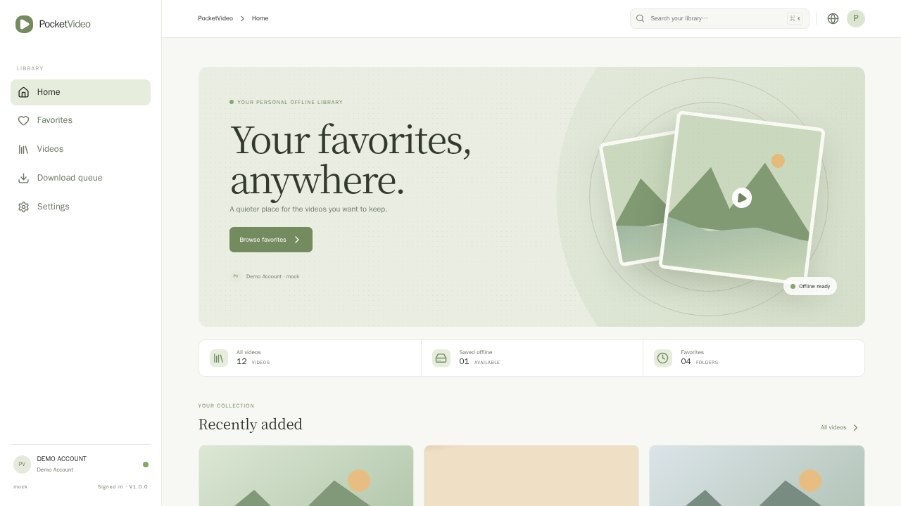

# PocketVideo

A Bilibili favorite-folder archiver built as a **PocketJS-style reference app**:
a TypeScript/React client, a Go service that owns all state, and yt-dlp behind a
provider adapter. It runs as a normal desktop Linux application today and is
structured so the same contracts can move to PJOS / the PocketJS Runtime and a
`.pj` package later.



## Why this shape

```text
React + TypeScript (PocketJS surface)
        │  JSON over HTTP (one API module)
        ▼
Go service  ── SQLite (favorites, videos, tasks, settings)
        │
        └── VideoProvider adapter ── MockProvider (demo)
                                   └─ YtDlpProvider (real downloads)
```

- The UI never executes commands, reads SQLite, or touches the filesystem.
- Downloads, retries, pause/resume, media streaming, and artwork extraction live
  in Go.
- Mock mode is a complete product demo: four favorite folders, twelve videos,
  playable generated media, download progress, and offline playback without a
  Bilibili account.
- Every screen, string, and control is designed for 320×240 handhelds as well as
  desktop, with keyboard, gamepad, touch, and mouse input.

## Features

| Area | What is implemented |
| --- | --- |
| Library | Favorite folders, all-video grid, search by title/creator, deep links |
| Downloads | Video and audio tasks, progress, pause/resume, queue cleanup, deduplication |
| Offline | Downloaded video and audio playback, extracted cover art |
| Sync | Manual sync, automatic sync at a configurable interval |
| Settings | Language, light/dark/system theme, cache and download directories, sync interval, auto-sync, proxy |
| i18n | English, 简体中文, 日本語 with compile-time key parity plus runtime tests |
| Devices | 320×240, 480×320, 640×480, 720×720, 1280×720, 1920×1080; 1×–3× DPI; compact handheld list layout |
| Input | Mouse, touch, arrow keys, Enter/Esc, `/` and ⌘/Ctrl+K search, Gamepad API |

## Quick start

Requirements: Go 1.24+, Node.js 22+, npm, and `ffmpeg` (mock media and cover
extraction). yt-dlp is only needed for the live provider.

```sh
# terminal 1 — Go service (mock mode)
make backend

# terminal 2 — Vite dev server with /api proxy
cd apps/pocket-video/frontend
npm install
npm run dev
```

Open <http://127.0.0.1:5173>. Data lives in `apps/pocket-video/backend/data`
(`POCKETVIDEO_DATA` overrides it); delete that directory to reset the demo.

Run every check, including the screenshot gallery, from the repository root:

```sh
make test
```

## Development mode

`MockProvider` is the default and needs no credentials. It reports a demo account
through `GET /api/account`, seeds four folders and twelve videos on first start,
and creates real, playable MP4/M4A files with ffmpeg when a download starts. Demo
media is a short synthetic gradient clip (8 seconds) while the catalog metadata is
synthetic Bilibili-style metadata; this is why a demo player clock is shorter than
the listed video duration.

## Live provider

```sh
POCKETVIDEO_PROVIDER=ytdlp YT_DLP_BINARY=/usr/bin/yt-dlp make backend
```

- Downloads run inside Go with `--continue`, the configured proxy, and progress
  parsed from yt-dlp output.
- Authenticated favorite listing is **not** implemented: there is no Bilibili
  login flow yet, so sync returns an explicit `provider_unavailable` error. No
  cookies or credentials are stored in the repository or database.
- A future `BBDownProvider` implements the same `VideoProvider` interface; see
  [docs/DEVELOPMENT.md](docs/DEVELOPMENT.md).

## Documentation

- [docs/ARCHITECTURE.md](docs/ARCHITECTURE.md) — boundaries, request flow, adapters, portability
- [docs/API.md](docs/API.md) — every endpoint, payload, and error
- [docs/DATABASE.md](docs/DATABASE.md) — schema, migrations, state machine
- [docs/DEVELOPMENT.md](docs/DEVELOPMENT.md) — local workflow, mock data, new providers, layout rules
- [docs/PACKAGING.md](docs/PACKAGING.md) — `.pj` / PJOS migration plan
- [docs/ROADMAP.md](docs/ROADMAP.md) — implemented, next, not implemented
- [docs/SCREENSHOTS.md](docs/SCREENSHOTS.md) — verified screenshot gallery

## Layout

```text
apps/pocket-video/
  backend/            Go service: API, SQLite, providers, download workers
  frontend/           React + TypeScript client (PocketJS surface)
    src/api.ts        the only module that performs HTTP
    src/pages/        one component per screen
    src/components/   shell, cards, audio player, empty states
  docs/               architecture, API, database, roadmap, screenshots
  tests/              frontend unit tests (Node test runner)
```

## Verified states

`docs/screenshots/` contains 21 live captures: home, favorites, a folder, the
library, video detail with offline playback, audio detail, queue, settings,
Chinese and Japanese UI, dark theme, six viewport sizes, and four DPI scales.
`make test` fails if any image is missing, has the wrong pixel size, is a
duplicate, or if a target viewport shows horizontal overflow.

## Limitations

- No Bilibili login; authenticated favorite sync and yt-dlp playlist sync are
  future work.
- Demo media is synthetic, not Bilibili content.
- Browsers define the current media/codec surface; PJOS permissions and codecs
  still need runtime validation (see [docs/PACKAGING.md](docs/PACKAGING.md)).
